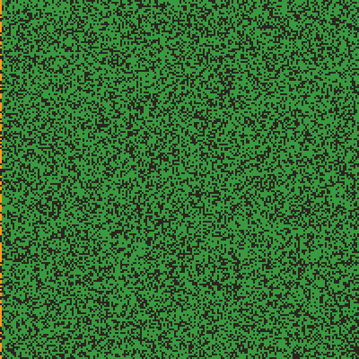
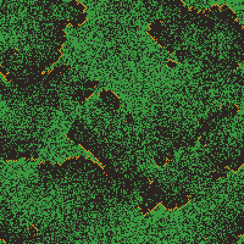
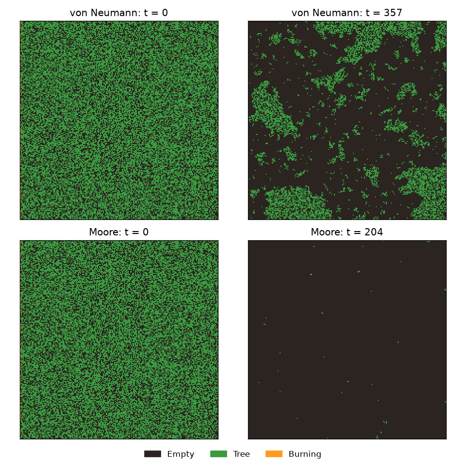
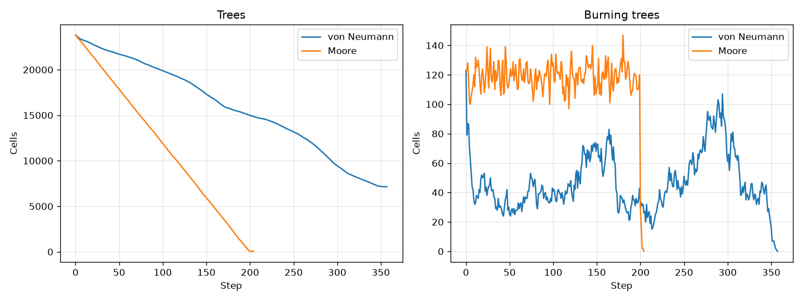
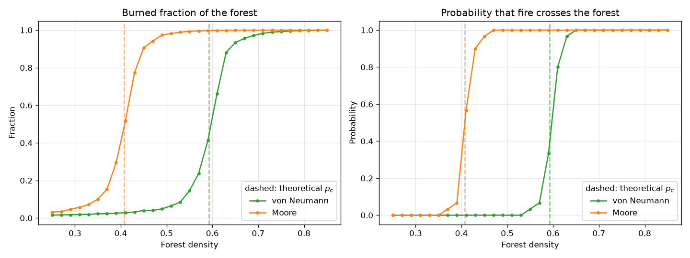
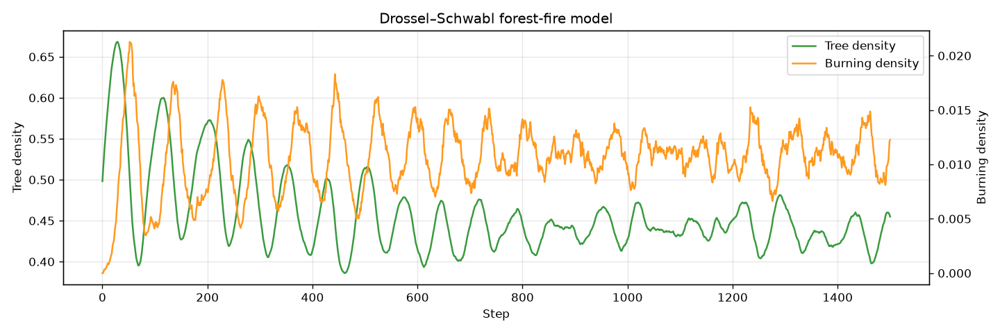

# Клеточный автомат лесного пожара

[](https://github.com/yndarra/forest-fire-simulation/actions/workflows/tests.yml)


[English](README.md) | **Русский**

Моделирование распространения лесного пожара двумерным клеточным автоматом.
В проекте разобраны две классические постановки. Первая — одиночный пожар в
случайном лесу, по сути задача **перколяции по узлам**. Вторая — **модель
Драсселя–Швабля**: деревья непрерывно растут и сгорают, и система сама
приходит в критическое состояние.

<p align="center">
  
  &nbsp;
  
</p>
<p align="center"><sub>Слева — фронт пожара, плотность 0.62, окрестность фон Неймана. Справа — установившийся режим модели Драсселя–Швабля.</sub></p>

> Курсовая работа по дисциплине «Компьютерное моделирование».

## Модель

Каждая клетка прямоугольной решётки находится в одном из трёх состояний:
**пусто**, **дерево** или **горит**. Все клетки обновляются одновременно:

| Текущее состояние | Условие | Следующее состояние |
|---|---|---|
| Горит | всегда | Пусто |
| Дерево | есть хотя бы один горящий сосед | Горит |
| Дерево | иначе, с вероятностью `p_lightning` | Горит |
| Пусто | с вероятностью `p_growth` | Дерево |

Поддерживаются две окрестности:

* **фон Неймана** (`+`) — 4 соседа по сторонам;
* **Мура** (`x` + `+`) — 8 соседей, включая диагональных.

Граница поля не периодическая: за краем леса нет.

Шаг автомата полностью векторизован на NumPy. Соседей ищем сдвигами маски
горящих клеток, без циклов Python по клеткам, поэтому шаг на поле 200 × 200
занимает меньше миллисекунды.

## Эксперименты

### 1. Одиночный пожар

Лес плотности 0.6, поджигается весь левый край. В окрестности Мура огонь
перескакивает ещё и по диагонали, поэтому тот же самый лес выгорает почти
целиком. Для окрестности фон Неймана плотность 0.6 лежит прямо на критической,
и крупные острова леса уцелели.




### 2. Порог перколяции

Для каждой плотности от 0.25 до 0.85 программа прогоняет 30 независимых лесов
размером 100 × 100 и считает две величины: долю сгоревших деревьев и то, как
часто огонь доходит до противоположного края. Обе кривые резко скачут вблизи
теоретических **порогов перколяции по узлам** квадратной решётки (пунктир).



| Окрестность | Измеренный p<sub>c</sub> (вероятность пересечения ≥ 0.5) | Теория |
|---|---|---|
| фон Неймана | ≈ 0.61 | 0.5927 |
| Мура | ≈ 0.41 | 0.4073 |

Измеренный порог для окрестности фон Неймана немного выше теоретического.
Так и должно быть для конечной решётки 100 × 100.

### 3. Модель Драсселя–Швабля

Здесь `p_growth = 0.02`, `p_lightning = 2·10⁻⁵`. После переходного процесса
с затухающими колебаниями плотность леса устанавливается около **≈ 0.44** и
дальше флуктуирует: пожары всех масштабов выжигают участки, которые потом
медленно зарастают. Это хрестоматийный пример **самоорганизованной
критичности**.



## Запуск

```bash
git clone https://github.com/yndarra/forest-fire-simulation.git
cd forest-fire-simulation
python -m venv .venv
.venv/Scripts/activate        # Windows; в Linux/macOS: source .venv/bin/activate
pip install -r requirements.txt

python main.py                # все эксперименты, картинки — в images/
python main.py fire           # один эксперимент: fire | sweep | ds
python main.py sweep --runs 50 --seed 42
```

Все эксперименты считаются примерно за 15 секунд. Результаты воспроизводимы,
потому что seed генератора фиксирован (`--seed`, по умолчанию 1097).

Тесты:

```bash
pip install -r requirements-dev.txt
pytest
```

## Структура проекта

```
forest_fire/
├── model.py          # состояния клеток, окрестности, автомат ForestFire
├── experiments.py    # одиночный пожар, перколяция, модель Драсселя–Швабля
└── visualization.py  # графики и быстрый рендер GIF через Pillow
tests/                # юнит-тесты правил автомата
main.py               # точка входа (командная строка)
```

## Литература

* B. Drossel, F. Schwabl. *Self-organized critical forest-fire model.* Phys. Rev. Lett. 69, 1629 (1992).
* D. Stauffer, A. Aharony. *Introduction to Percolation Theory.* Taylor & Francis, 1994.
* [Forest-fire model](https://en.wikipedia.org/wiki/Forest-fire_model) — Википедия.

## Лицензия

[MIT](LICENSE)
